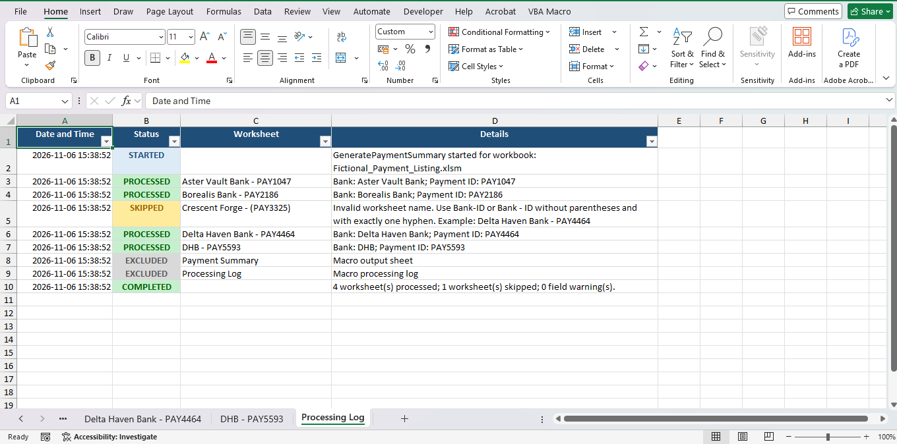

# Excel PivotTable Payment Summary

A personal Excel VBA utility that builds a centralized payment summary from bank/payment worksheets. It creates a PivotTable for each eligible worksheet, groups the data by currency and transaction type, sums the amount, and records the run in a processing log.

The repository includes the VBA module (`PaymentSummary.bas`) and a fictional macro-enabled example workbook (`Fictional_Payment_Listing.xlsm`).

## Screenshots

### Completed payment summary

### Processing log

## Why this macro exists

Preparing a consolidated payment summary manually can take 20–30 minutes, and sometimes considerably longer depending on the number of worksheets and the volume of data. This macro automates the repetitive work of creating and arranging PivotTables, compiling payment IDs, and checking worksheets, helping reduce the task to a single click of a button while providing a processing log for skipped sheets and missing fields.

## What the macro does

Run `GeneratePaymentSummary` to have the macro:

- Scan visible worksheets in the active workbook.
- Exclude the `RAW` sheet and the macro's administrative sheets.
- Read each eligible sheet's bank name and payment ID from its worksheet name.
- Create a PivotTable using `Currency` and `Types` as row fields and `Amount` as a summed data field.
- Add the bank name and payment ID beside each PivotTable on a `Payment Summary` sheet.
- Create a `Processing Log` sheet with processed, skipped, excluded, warning, and error entries.
- Display a completion message with totals for processed sheets, skipped sheets, and missing-field warnings.

The macro uses the active workbook as its target, so if it is stored in `PERSONAL.XLSB`, activate the workbook you want to process before running it.

## Requirements for source worksheets

Each source worksheet must meet these requirements:

1. It is visible and is not named `RAW` (case-insensitive), `Payment Summary`, or `Processing Log`.
2. Its name contains exactly one hyphen separating the bank name from the payment ID. Spaces around the hyphen are optional.
3. Row 1 contains the source-data headers, with data beginning below the header row.
4. Column A contains values through the last source-data row. The macro uses column A to find that row and row 1 to find the last source column.
5. The required PivotTable headers are exactly `Currency`, `Types`, and `Amount` by default.

Valid worksheet-name examples:

- `Delta Haven Bank-PAY4464`
- `Delta Haven Bank - PAY4464`

Names with parentheses, more than one hyphen, or a blank bank name/payment ID are skipped. For example, `Delta Haven Bank-(PAY4464)` and `Delta Haven Bank-PAY-4464` are invalid.

If a required header is missing, the sheet may still be processed, but the missing field is logged as a warning and that field will not be added to its PivotTable.

## Run the macro

### Use the example workbook

1. Download and open `Fictional_Payment_Listing.xlsm` in the desktop version of Excel.
2. Enable macros only if you trust the workbook and its source.
3. Activate the workbook, then run `GeneratePaymentSummary` from Excel's macro dialog (`Alt+F8` on Windows).
4. Review the `Payment Summary` and `Processing Log` sheets.

### Use the module in another workbook

1. Save the target workbook as an Excel Macro-Enabled Workbook (`.xlsm`).
2. Open the VBA editor (`Alt+F11` on Windows), and use **File → Import File…** to import `PaymentSummary.bas`.
3. Return to the target workbook, activate it, and run `GeneratePaymentSummary` (`Alt+F8` on Windows).

Excel's macro security settings may need to allow macros for a trusted file. Do not enable macros in files from untrusted sources.

## Output and reruns

Each run deletes and recreates the `Payment Summary` and `Processing Log` worksheets. Existing content on sheets with those names—including a prior run's log—is not retained. Back up or rename any sheets with those names if you need to keep their contents.

The summary is moved to the first worksheet position. The log records details for each sheet and is also printed to the VBA Immediate window for developers.

## Configuration

The main settings are at the top of `PaymentSummary.bas`:

- `OUTPUT_SHEET_NAME` and `PROCESSING_LOG_SHEET_NAME`: output sheet names.
- `FIELD_DOCUMENT_CURRENCY`, `FIELD_TRANSACTION_TYPE`, and `FIELD_DOCUMENT_AMOUNT`: source header names.
- `OUTPUT_START_ROW`, `OUTPUT_START_COLUMN`, and `PAYMENT_ID_COLUMN`: report layout.

Additional customization points:

- Add or remove excluded sheet names in `IsExcludedSheet` (the example excludes `RAW`).
- Edit the optional bank display-name mappings in `BankDisplayName`. Unmapped bank names are displayed as written in the worksheet name.

## Repository contents

- `PaymentSummary.bas` — VBA module.
- `Fictional_Payment_Listing.xlsm` — fictional sample workbook.
- `LICENSE` — repository license.
